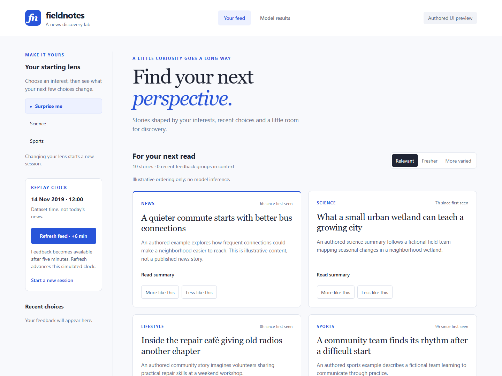

# Session-Aware News Recommendation

**Fieldnotes** is a local news recommendation application built around a trained
content retriever, a delayed-feedback session ranker, and an auditable chronological
evaluation. Browse stories, save or dismiss them, adjust freshness and variety,
inspect ranking details, and compare measured model results.

The system combines TensorFlow/TFRS, an exact temporal FAISS index, FastAPI,
PostgreSQL, Redis and local MLflow tracking. It is a research demonstration:
catalog recall is low, and offline ranking does not establish live engagement lift.



*This screenshot uses invented stories and deterministic UI fixtures. It shows
the interface, not trained inference or benchmark results. Screenshots of the
verified model-backed demo stay private because they contain licensed news text.*

## Try the interface

From a clone of this repository, using Python 3.11 or later:

```sh
python -m venv .venv
# Activate .venv for your shell.
python -m pip install -e . -r requirements/browser.txt
python -m uvicorn examples.preview:create_preview --factory --host 127.0.0.1 --port 8025
```

Open **http://127.0.0.1:8025**. This explicitly labeled authored preview needs no
dataset, model weights, Docker or account. Its illustrative comparison numbers
are not experimental evidence. Stop it with Ctrl+C.

For **real model inference**, follow the [demo guide](docs/demo.md), including
[licensed data access](docs/data.md), [model reproduction](docs/session-ranking.md)
and [service setup](docs/service.md). The real demo uses stories from the training
archive, synthetic interest profiles, explicit feedback and a historical clock.
Final evaluation contributes aggregate comparison statistics only; no final
test cases enter the feed. The [mobile preview](docs/images/authored-preview-mobile.png)
uses the same authored fixtures.

## Final heldout results

The reserved official MIND-small validation archive contains **73,152 impressions
on November 15, 2019**, 2,740,998 logged candidates and 111,383 positives.
Every impression, candidate and positive is retained, including 132 positives
unavailable for temporal retrieval. The observed catalog contains 65,238 articles.
All three learned models, policies and fitting counts were frozen before opening
the archive. No final outcome changed a model, threshold or exclusion.

| Frozen model | Logged AUC | Logged nDCG@10 | Catalog recall@100 |
| --- | ---: | ---: | ---: |
| Popularity | 0.4950 | 0.2808 | 0.267% |
| Learned content retrieval | 0.5957 | 0.3605 | 1.198% |
| Long-history-only ranker | 0.5949 | 0.3598 | — |
| Session ranker | 0.5989 | 0.3623 | 1.263% |

Logged metrics rank the observed candidate slate. Catalog recall instead uses all
earlier observed articles and counts only known logged positives; unexposed
relevance is unknown. Popularity and content each retrieve 100 candidates, while
the session ranker reranks their deduplicated union. Different candidate pools
limit attribution to the ranker alone. The union's recall ceiling is only **1.400%**.

Only 4,003 final impressions have eligible session feedback. In this segment,
session nDCG@10 is **0.36146**, slightly below long-history-only **0.36168**.
Thus the small aggregate improvement does not establish a session-context benefit
in every group. Empty-history session catalog recall@100 is just **0.00753%**.
One seed and one fixed configuration do not establish statistical significance.

| Catalog session policy | Recall@10 | Categories@10 | First-seen age, hours@10 |
| --- | ---: | ---: | ---: |
| Relevance | 0.394% | 3.14 | 56.52 |
| Freshness | 0.516% | 3.17 | 28.76 |
| Balanced variety | 0.458% | 3.68 | 35.19 |

These fixed presets trade ranking, age and category mix. First observation is
not publication time. Freshness uses a 24-hour exponential decay scale
(about 16.64-hour half-life). Scores are uncalibrated.

**Replay semantics:** earlier final clicks may update later session context only
after a strict five-minute delay; a gap greater than 30 minutes resets the session.
Current, equal-time and future outcomes never enter a query. Every prediction was
frozen before metrics were aggregated. This is a causal replay using delayed
labels, not an entirely label-free simulation. MIND lacks actual click times,
session boundaries, publication times and exposure propensities.

See [final methods and reproduction](docs/final-evaluation.md), the
[complete report](results/heldout-v1/report.json),
[frozen protocol](results/heldout-v1/protocol.json),
[independent audit](results/heldout-v1/audit.json) and
[runtime record](results/heldout-v1/runtime.json). All segment, exposure-frequency,
article-macro, coverage and daily views remain available. No unbiased propensity
correction, causal engagement result or full-catalog AUC is claimed.

## Earlier development evidence

Fitting uses 95,071 impressions from November 9–12; chronological development
uses all 61,894 impressions, 2,454,102 candidate entries and 94,786 positives from
November 13–14 inside the training archive. These stages preceded final evaluation.
Their original reports and `final_holdout_opened: false` flags are preserved.

The content encoder has 2,105,408 parameters and was trained for three fixed
epochs on all 141,558 fitting clicks. A frozen mean-history representation retrieves
articles using title/category content, including new article IDs. Two 33,281-parameter
rankers compare longer history with a 32-unit GRU using delayed session feedback.
No model was selected or retuned using final outcomes.

| Development model | Logged AUC | Logged nDCG@10 | Catalog recall@100 |
| --- | ---: | ---: | ---: |
| Popularity | 0.5015 | 0.2806 | 3.582% |
| Learned content | 0.6141 | 0.3602 | 2.251% |
| Long-history-only | 0.6146 | 0.3641 | — |
| Session | 0.6202 | 0.3680 | 3.395% |

Content retrieval underperformed popularity on development catalog recall despite
better logged ranking. Session article-macro recall@10 also fell below long-history-only
(0.3879 versus 0.3917). These limitations remain part of the evidence.
See [baseline evaluation](docs/evaluation.md), [content retrieval](docs/retrieval.md)
and [session modeling](docs/session-ranking.md) for training, audits and exact hashes.

## Service and compute evidence

The [service audit](results/service-v1/report.json) matched 384 preserved development
slates and 7,680 scores across three policies. SQL idempotency, delayed feedback,
dismissals, two-worker revisions, restart and dependency-failure recovery were tested.
The local service supports content insertion with the frozen encoder, durable
receipts/feedback and an optional revision-aware Redis cache.

Measured HTTP p95 was **76.11 ms** for 383 serial uncached requests and **41.30 ms**
for 128 cache hits. Four clients making 64 uncached requests measured p95 **167.82 ms**
and **25.49 requests/s**. The first lazy-index request took 1.12 s. A separate
65-request probe measured 554,917,888 bytes peak actual API worker RSS. These are
bounded local measurements, not a production capacity guarantee; Docker, clients
and unrelated applications are excluded from worker memory.

Final prediction, recording and inline checks took **538.38 seconds** internally
with four CPU threads. The external actual-worker peak was **750,829,568 bytes**;
metric aggregation, independent audit, Docker and other applications are excluded.
The independent audit checks every impression and metric group, while 128 exhaustive
float64 retrieval checks and 256 reload predictions per learned arm verify numerical
behavior. CPU reload equality does not guarantee cross-platform retraining equality.

The [release evidence](results/release-v1/manifest.json) records desktop/mobile
browser verification, package installation and local MLflow metrics/artifact checks.
The application is loopback-only and has no public-user authentication or automatic
retention policy. See [service contracts](docs/service.md) and [demo operation](docs/demo.md).

## Reproduce and verify

The lightweight ingestion and baseline workflow has no runtime dependencies:

```sh
python -m pip install -e . -r requirements/test.txt
python -m pytest -q
newsrec ingest --news /private/mind/train/news.tsv --behaviors /private/mind/train/behaviors.tsv --database /private/news.sqlite --cutoff 2019-11-13T00:00:00
newsrec evaluate --database /private/news.sqlite --output /private/baseline-report.json
python scripts/verify_evidence.py
python scripts/verify_retrieval.py
python scripts/verify_session.py
python scripts/verify_service.py
python scripts/verify_final.py
```

Optional model, service, browser and tracking tests require their pinned environments;
otherwise those modules skip explicitly. Fixtures are authored, not benchmark evidence.
CI exercises the lightweight package, trained-model fixtures, dedicated PostgreSQL/Redis,
browser interactions and local MLflow round trips. See the [CI configuration](.github/workflows/ci.yml).

Version 1.0.0 includes an installable Python wheel with the demo's HTML/CSS/JavaScript.
Use a repository clone for examples, scripts, aggregate reports and deployment files.
Model weights and raw MIND data are not redistributed. Reproduce the frozen artifacts
locally with the documented commands and compare their hashes and numerical tolerances.
Data access remains subject to the publisher's noncommercial research terms.
Keep raw text, anonymized user IDs, credentials and per-impression predictions private.
